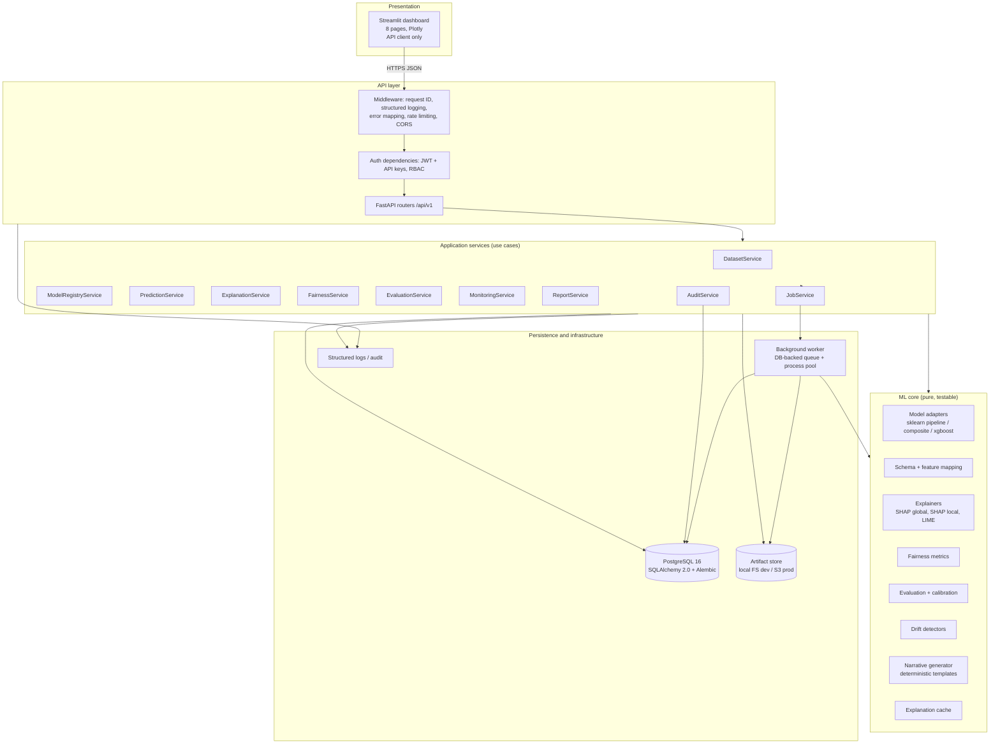
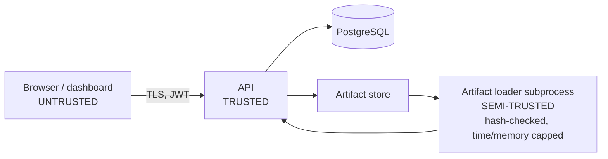
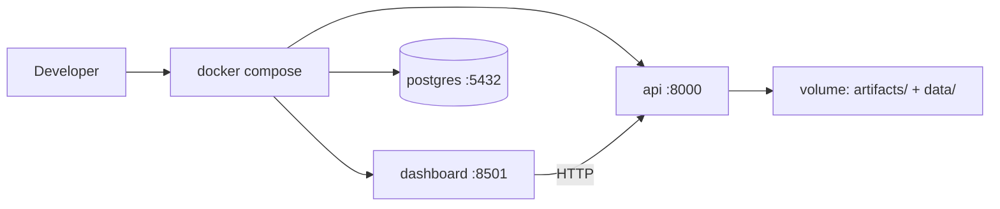

# System Architecture — Aletheia

| Field | Value |
|---|---|
| Version | 1.0 (Stage 0 baseline) |
| Date | 2026-11-03 |
| Status | Awaiting validation |

---

## 1. Architecture drivers

The design is forced by five constraints, in priority order:

1. **Faithfulness** — explanations must be recomputable and numerically checkable against the model, so the
   ML layer must own the model object, the preprocessing transform and the raw↔encoded feature mapping.
2. **Lineage** — every output must resolve to `model_version` + `dataset_version` + artifact hash. This is a
   data-model constraint before it is a UI feature.
3. **Untrusted artifacts** — model files can contain arbitrary code. Loading must happen behind an explicit
   trust boundary, not on a request thread with no policy.
4. **Bounded scope** — one operator, ~7k-row datasets, single node. No microservices, no message broker, no
   Kubernetes. Complexity must earn its place.
5. **Replaceable edges** — the dashboard is a client of the API; the API is a client of the ML layer. Each
   edge has one contract, so any layer can be swapped without rewriting the others.

---

## 2. Layered view



**Dependency rule:** `api → services → ml`, with `ml` importing nothing from `api`, `services`, `db` or
`dashboard`. The dashboard imports only its own client module. This is enforced by an architecture test
(import-graph assertion), not by convention alone.

---

## 3. Target repository structure (Stage 1)

```text
.
├── pyproject.toml                  # single distribution: aletheia (+ dashboard extras)
├── src/aletheia/
│   ├── api/
│   │   ├── deps.py                 # auth, db session, pagination, request context
│   │   ├── errors.py               # exception → RFC 9457 problem+json
│   │   ├── middleware.py           # request ID, timing, logging
│   │   └── v1/routers/
│   │       ├── auth.py  datasets.py  models.py  predictions.py
│   │       ├── explanations.py  fairness.py  evaluations.py
│   │       ├── drift.py  reports.py  jobs.py  system.py
│   ├── core/
│   │   ├── config.py               # pydantic-settings, env-driven
│   │   ├── logging.py              # structlog JSON, redaction
│   │   ├── security.py             # JWT, API-key hashing, RBAC
│   │   ├── ratelimit.py            # per-identity limiter
│   │   ├── retention.py            # bounded, dry-runnable purge
│   │   └── jobs/
│   │       ├── queue.py            # enqueue/claim/complete, DB-backed
│   │       └── worker.py           # loop, process pool, graceful drain
│   ├── db/
│   │   ├── base.py  session.py
│   │   ├── models/                 # ORM entities (see 04-database-design.md)
│   │   └── repositories/           # query objects, no business logic
│   ├── ml/
│   │   ├── adapters/               # base protocol, sklearn.py, xgboost.py, registry.py
│   │   ├── schema.py               # FeatureSchema, FeatureSpec, compatibility diff
│   │   ├── artifacts/              # store, hashing, manifest, sandbox loader
│   │   ├── explain/                # shap_global.py, shap_local.py, lime_local.py,
│   │   │                           # feature_map.py, additivity.py, stability.py, cache.py
│   │   ├── fairness/               # metrics.py, definitions.py, groups.py
│   │   ├── evaluation/             # metrics.py, calibration.py, thresholds.py, errors.py
│   │   ├── drift/                  # psi.py, ks.py, chi2.py, detector.py
│   │   └── narrative/              # templates.py, render.py
│   ├── services/                   # orchestration; owns transactions and job payloads
│   ├── schemas/                    # Pydantic DTOs (request/response/domain)
│   └── reporting/                  # Jinja2 HTML, ReportLab PDF, CSV writers
├── dashboard/
│   ├── app.py                      # entry point, navigation, session state
│   ├── api_client.py               # the only HTTP surface used by pages
│   ├── components/                 # charts, caveat banners, metric cards, tables
│   └── pages/                      # 1_Executive_Overview.py ... 8_Reports.py
├── migrations/                     # Alembic environment + versions
├── data/                           # gitignored datasets; fetch script + checksums
├── artifacts/                      # gitignored artifact store (dev)
├── scripts/
│   ├── fetch_datasets.py           # download + SHA-256 verify
│   ├── train_churn.py              # Stage 2 training CLI (logreg + xgboost)
│   ├── register_churn.py           # Stage 3 registration of existing v1.0.0
│   ├── seed_demo.py                # demo dataset/model/assessment seeding
│   └── run_retention.py            # retention purge (cron/dry-run)
├── tests/
│   ├── unit/  integration/  e2e/  contracts/  fixtures/
├── docs/
├── docker/                         # Dockerfile.api, Dockerfile.dashboard, entrypoints
├── docker-compose.yml
└── .github/workflows/ci.yml
```

---

## 4. The ML core contracts

These interfaces are the heart of the design and are fixed in Stage 0 so later stages implement against
them rather than inventing them ad hoc.

### 4.1 Model adapter

```python
class ModelAdapter(Protocol):
    adapter_name: str                       # "sklearn_pipeline" | "sklearn_composite" | "xgboost_native"
    framework: str                          # "scikit-learn" | "xgboost"
    framework_version: str

    def load(self, artifact_path: Path) -> LoadedModel: ...
    def feature_schema(self, model: LoadedModel) -> FeatureSchema: ...

class LoadedModel(NamedTuple):
    estimator: Any                          # exposes predict_proba
    preprocessor: Any | None                # None when the estimator already encodes it
    transformed_feature_names: list[str]
    feature_map: FeatureMap                 # transformed column -> source column + human label
    classes: list[str]
    background: pd.DataFrame | None         # SHAP masker, deterministic
```

`AdapterRegistry` selects by declared artifact format + inspected object type, and refuses unsupported
objects with `UNSUPPORTED_ARTIFACT`. It must accept the composite dict found in the existing churn artifact
(`{"model", "preprocessor", "feature_names", "metadata"}`) — verified in
`docs/02-existing-artifact-assessment.md`.

### 4.2 Explainers

```python
class GlobalExplainer(Protocol):
    method: str                             # "shap"
    def explain(self, model: LoadedModel, X: pd.DataFrame,
                params: GlobalParams) -> GlobalResult: ...

class LocalExplainer(Protocol):
    method: str                             # "shap" | "lime"
    def explain_one(self, model: LoadedModel, row: pd.Series,
                    params: LocalParams) -> LocalResult: ...
```

Explainer selection is explicit, not magical:

| Estimator family | Global | Local | Notes |
|---|---|---|---|
| Linear (logistic regression) | `shap.LinearExplainer` | `LinearExplainer` | Exact, fast, additive in log-odds |
| Tree ensemble (XGBoost) | `shap.TreeExplainer` | `TreeExplainer` | Exact for the tree model; `model_output="raw"` documented |
| Any other | `KernelExplainer` (sampled) | `KernelExplainer` | Slow, approximate; row limit + explicit warning surfaced |
| Cross-check | — | `LIME` | Surrogate only; fidelity stored and labelled |

`additivity.py` verifies `base_value + Σ φ ≈ model output` on a sample before results are persisted; a
failure raises `EXPLANATION_FIDELITY_ERROR` instead of storing a misleading explanation.

### 4.3 Feature mapping

One-hot preprocessing expands 21 raw fields into 46 encoded columns. The UI must show *raw* values with
readable statements, so every explanation carries:

```python
FeatureMap = {
  "Contract_Month-to-month": FeatureRef(
      transformed_name="Contract_Month-to-month",
      source_column="Contract",
      source_value="Month-to-month",
      readable_label="Month-to-month contract",
      kind="one_hot_category",
  ),
  "tenure": FeatureRef(source_column="tenure", readable_label="Customer tenure (months)", kind="numeric"),
}
```

This mapping is derived from the fitted `ColumnTransformer` and validated against the known prefix quirk
(`num__`/`cat__`) found in the existing artifact. Aggregating encoded one-hot contributions back to their
source column is available as an explicit view ("grouped by field") and is labelled as an aggregation of
attributions, not a different model.

### 4.4 Background/reference selection

- Background for SHAP is a deterministic sample of the model's reference dataset version
  (`sample(n=100, random_state=seed)`), recorded by dataset version ID + row-index hash.
- Global explanation input is either the reference dataset version or a user-selected dataset version.
- Cache key = `sha256(artifact_sha256 | reference_hash | input_hash | method | canonical_params | library_versions)`.
  Identical key → stored result; any change → recompute. Immutable inputs make indefinite caching safe.

---

## 5. Execution model: synchronous vs background

ML work is CPU-bound. FastAPI endpoints are declared `def` (not `async def`) so they run in the threadpool;
SHAP-heavy work additionally executes in a process pool to avoid GIL contention and to bound memory.

| Operation | Mode | Rationale | Budget |
|---|---|---|---|
| Auth, list/get metadata | sync | DB only | p95 ≤ 100 ms |
| Single prediction | sync | ms-scale transform + predict | p95 ≤ 150 ms |
| Local explanation (SHAP+LIME) | sync | ~1–2 s | p95 ≤ 2.5 s |
| Global explanation | job | seconds–minutes; artifact generation | ≤ 20 s / 7k rows |
| Batch prediction | job | arbitrary size | ≤ 60 s / 7k rows |
| Fairness assessment | job | multi-group metrics + reports | ≤ 10 s |
| Evaluation (metrics + calibration + sweep) | sync | < 3 s on 7k rows; cached dataset in memory | p95 ≤ 3 s |
| Drift report | job | dataset-scale comparison | ≤ 10 s |
| Report generation | job | PDF layout + image embedding | ≤ 15 s |

**Job system (deliberate simplification):** a `jobs` table plus an in-process worker loop
(`JobQueue.enqueue` → `UPDATE ... SET status='running' WHERE id = (SELECT ... FOR UPDATE SKIP LOCKED)`) and a
`ProcessPoolExecutor` for CPU work. No Redis, no Celery, no broker to operate. Jobs are idempotent via a
unique `idempotency_key`, retried up to `max_attempts` with failure classification, and marked
`interrupted` on graceful shutdown so they can be re-queued.

**Escalation trigger (documented, not speculative):** if any job class exceeds 60 s at the p95 on reference
data, or the deployment needs more than one API replica, move to Celery + Redis. The `JobQueue` interface and
job-payload DTOs are broker-agnostic so the swap does not touch services.

---

### 5.1 Model loading, memory and the process pool

The design review found this path under-specified: a per-process cache combined with a process pool
multiplies memory and multiplies the number of times an untrusted pickle is executed. The rules:

- **The parent never unpickles.** The API process reads the bytes, checks size and SHA-256, and asks a
  worker for metadata (schema, feature map, library versions), receiving plain JSON back.
- **One unpickle per artifact per worker, not per request.** Each worker holds an LRU of at most 2
  `LoadedModel`s keyed by `artifact_sha256`; a hit is a dictionary lookup. The hash is re-validated before
  loading, and a failed load is never cached.
- **Workers are scrubbed.** Children are spawned with an environment stripped of `DATABASE_URL`,
  `SECRET_KEY` and provider keys, so an artifact that executes code on unpickle reaches no credential and
  no database handle.
- **Load once, measure once, record it.** `maxtasksperchild=50` bounds slow leaks. Worker start cost and
  peak RSS are measured at the Stage 4 gate and written into this document; the estimate below is not a
  substitute for that measurement.
- **Budget.** Workers default to `min(4, cpu_count - 1)`. Per worker: the churn composite artifact is a
  logistic regression plus a `ColumnTransformer` (well under 5 MB), the SHAP background is 100 × 46
  float64 (~37 KB), and a 7,043 × 46 float64 batch frame is ~2.6 MB. Peak per worker is dominated by the
  batch frame, so four workers sit in the tens of megabytes — the constraint is CPU, not RAM. A
  gradient-boosted model with hundreds of trees changes the constant, not the conclusion; a measured value
  more than 2× this estimate is treated as a finding, not a footnote.
- **Degraded mode is explicit.** If a worker cannot start, or an artifact fails re-validation, the endpoint
  returns `503 ARTIFACT_UNAVAILABLE` with `Retry-After`. It never falls back to an in-process unpickle.

---

## 6. State, transactions and consistency

- One SQLAlchemy `Session` per request, closed in a dependency; services own commit/rollback boundaries.
- Long jobs use their own short-lived sessions per step (no session held across an ML computation).
- Predictions are written in batches of ≤ 1,000 rows inside a transaction; job progress is updated after each
  batch so a crash leaves an inspectable, resumable state.
- Artifacts are written to the store first, then the DB row is committed (orphan files are collected by a
  maintenance script; a DB row never points at a missing file unnoticed — a startup consistency check
  reports it).
- Immutability: `model_versions`, `dataset_versions`, `predictions`, `explanation_runs` and `audit_events`
  are insert-only. Corrections create new rows.

---

## 7. Security architecture

### 7.1 Trust boundaries



1. **Uploaded data** (CSV) is untrusted content: type/size limits, header validation, formula-injection
   neutralisation on export, no execution, no `eval`.
2. **Model artifacts** may contain pickle payloads that execute on deserialisation. Policy:
   - Production registration accepts artifacts **only** from a server-controlled import directory or an
     allowlisted hash manifest; upload endpoints are disabled unless `ALLOW_ARTIFACT_UPLOAD=true`.
   - Preferred formats: XGBoost native `.json`/`.ubj`, or a re-serialised sklearn `Pipeline` produced by this
     project's own training CLI.
   - Any load happens in a **subprocess** with a timeout, memory cap and no network, in the Linux container
     where `resource` limits are enforceable; the parent validates the exit code and the manifest.
   - The SHA-256 is verified against the registered value *before* loading; a mismatch is
     `ARTIFACT_INTEGRITY_FAILED`.
   - Limitations of the sandbox (no seccomp profile in v1; pickle remains code execution) are documented in
     `docs/11-security.md`, not hidden.
3. **Privacy**: subject identifiers are salted-SHA-256 pseudonymised; stored inputs are minimised by an
   allowlist; de-pseudonymisation requires admin and writes an audit event.
4. **Secrets**: environment only (`pydantic-settings`), `.env` gitignored, no secret echoed in logs or
   response bodies; the logger redacts known-sensitive keys.

### 7.2 Authentication and authorisation

- Human access: JWT bearer (short-lived access token), Argon2id password hashes, roles `viewer`,
  `analyst`, `admin`.
- Machine access: API keys (`X-API-Key`), stored as SHA-256 digests with a display prefix, scoped and
  revocable, per-key rate limits.
- Rate limiting: per identity, per endpoint class, in-process token bucket; the multi-replica caveat is
  documented and the limiter interface allows a Redis backend later.
- All mutations check role + resource existence and emit an audit event.

---

## 8. Observability

| Signal | Implementation |
|---|---|
| Request correlation | `X-Request-ID` accepted or generated, propagated into logs, jobs, audit rows |
| Logs | structlog JSON: timestamp, level, request_id, user_id, route, status, duration_ms; redaction filter |
| Metrics | counts/latency per route in logs; optional `/metrics` Prometheus endpoint behind a flag |
| Health | `GET /health` (process), `GET /health/ready` (DB + artifact store + migration head + worker heartbeat) |
| Job visibility | `jobs` table + `GET /jobs`; failed jobs retain error class and message |
| Model drift of the platform itself | explanation cache hit-rate and job duration recorded per run |

---

## 9. Deployment topologies

### 9.1 Local development (Stage 1)



Hot reload for both services in dev; tests run against a disposable Postgres database.

### 9.2 Cost-aware demo deployment

Single small container host (or a managed container platform) running API + dashboard, managed Postgres,
S3-compatible object storage, TLS terminated by the platform. Suitable for recruiters clicking a live demo.
Approximate cost: **$0–25/month** at demo scale (verify current provider pricing; free tiers change).

### 9.3 AWS reference deployment

ECS Fargate services (api, dashboard) behind an ALB · RDS PostgreSQL (small instance, Multi-AZ off) ·
S3 for artifacts · CloudWatch for logs · Secrets Manager for config.
Approximate cost: **$70–130/month** idle (verify current pricing). This is documented as the "production
path", not the default demo, because paying for idle Fargate to show a portfolio project is poor engineering.
A single EC2 instance with Docker Compose is the documented cheap alternative (~$10–20/month).

**Explicitly rejected:** Kubernetes, service mesh, multi-region. No requirement justifies them at this scale;
adding them would be infrastructure theatre.

---

## 10. Architectural decisions deferred to later stages

| Deferred item | Stage | Trigger |
|---|---|---|
| Re-serialise churn artifact as a canonical manifest | 2–3 | Needed for version-pinned reproducibility |
| Async SQLAlchemy | never (unless throughput demands) | Sync + threadpool covers the load; revisit only with evidence |
| Redis (rate limit / cache / queue) | 11+ | Multi-replica deployment or job p95 > 60 s |
| MLflow | 13 | Only if training experimentation genuinely outgrows the internal run table |
| Object-store signed URLs | 11 | Required when artifacts move to S3 |
| Multiclass dashboard depth | post-v1 | A demand case appears (adapter support exists from Stage 3) |

---

## 11. What would make this architecture wrong

Stated openly, so the design can be judged rather than assumed correct:

- If datasets were 10M+ rows, in-process pandas + process-pool SHAP would not hold; a distributed compute
  layer (Spark/Dask) and a real queue would be required.
- If many concurrent users generated explanations, cached artifacts would need a proper cache service and
  storage lifecycle policy instead of a DB-keyed cache.
- If artifacts came from untrusted third parties at scale, the subprocess sandbox would be insufficient and a
  hardened, isolated execution service (gVisor/Firecracker-class) would be mandatory.
