# Database Design — Aletheia

PostgreSQL 16, SQLAlchemy 2.0 (declarative, typed), Alembic migrations. All timestamps are `timestamptz`
stored in UTC. Primary keys are UUIDv4 except high-volume append-only tables, which use `bigint` identity for
index locality (`predictions`, `audit_events`, `drift_feature_results`, `fairness_group_metrics`).

---

## 1. Entity-relationship diagram

```mermaid
erDiagram
    USERS ||--o{ API_KEYS : owns
    USERS ||--o{ DATASETS : creates
    USERS ||--o{ MODELS : registers
    USERS ||--o{ REPORTS : requests

    DATASETS ||--o{ DATASET_VERSIONS : "has versions"
    DATASET_VERSIONS ||--o{ MODEL_VERSIONS : "trains / references"
    DATASET_VERSIONS ||--o{ PREDICTION_BATCHES : "scored over"

    MODELS ||--o{ MODEL_VERSIONS : "has versions"
    MODEL_VERSIONS ||--o{ PREDICTIONS : produces
    MODEL_VERSIONS ||--o{ PREDICTION_BATCHES : "batch runs"
    MODEL_VERSIONS ||--o{ EXPLANATION_RUNS : explains
    MODEL_VERSIONS ||--o{ FAIRNESS_ASSESSMENTS : assessed_by
    MODEL_VERSIONS ||--o{ EVALUATIONS : evaluated_by
    MODELS ||--o{ DRIFT_REPORTS : monitored_by

    PREDICTION_BATCHES ||--o{ PREDICTIONS : contains
    PREDICTIONS ||--o| PREDICTION_LABELS : "labelled by"
    PREDICTIONS ||--o| LOCAL_EXPLANATIONS : explained_by
    EXPLANATION_RUNS ||--o| GLOBAL_EXPLANATIONS : produces
    EXPLANATION_RUNS ||--o{ FEATURE_IMPORTANCES : ranks
    EXPLANATION_RUNS ||--o{ LOCAL_EXPLANATIONS : produces

    FAIRNESS_ASSESSMENTS ||--o{ FAIRNESS_GROUP_METRICS : per_group
    EVALUATIONS ||--o{ EVALUATION_METRICS : "threshold rows"
    DRIFT_REPORTS ||--o{ DRIFT_FEATURE_RESULTS : per_feature

    MODELS ||--o{ REPORTS : "reported in"
    JOBS ||--o{ REPORTS : generates
    USERS ||--o{ AUDIT_EVENTS : acts_in

    USERS {
        uuid id PK
        citext email UK
        text password_hash
        text role
        boolean is_active
        timestamptz created_at
        timestamptz last_login_at
    }
    API_KEYS {
        uuid id PK
        uuid user_id FK
        text key_prefix
        text key_hash UK
        text scope
        timestamptz last_used_at
        timestamptz revoked_at
    }
    DATASETS {
        uuid id PK
        text name UK
        text task_type
        text target_column
        text positive_class
        uuid created_by FK
        timestamptz created_at
    }
    DATASET_VERSIONS {
        uuid id PK
        uuid dataset_id FK
        text version
        text storage_uri
        text content_sha256
        integer row_count
        jsonb column_schema
        jsonb statistics
        jsonb quality_report
        text source
        text license
        timestamptz created_at
    }
    MODELS {
        uuid id PK
        text name UK
        text task_type
        text description
        uuid created_by FK
        timestamptz created_at
    }
    MODEL_VERSIONS {
        uuid id PK
        uuid model_id FK
        text version
        text status
        text artifact_uri
        text artifact_sha256
        text artifact_format
        text adapter_name
        text framework
        text framework_version
        text python_version
        jsonb feature_schema
        jsonb feature_map
        jsonb output_schema
        text target_column
        numeric threshold
        uuid training_dataset_version_id FK
        uuid reference_dataset_version_id FK
        text background_uri
        jsonb training_metrics
        jsonb hyperparameters
        jsonb provenance
        uuid registered_by FK
        timestamptz registered_at
    }
    PREDICTION_BATCHES {
        uuid id PK
        uuid model_version_id FK
        uuid dataset_version_id FK
        text status
        integer record_count
        integer failed_count
        text idempotency_key UK
        uuid requested_by FK
        timestamptz created_at
        timestamptz completed_at
    }
    PREDICTIONS {
        bigint id PK
        uuid batch_id FK
        uuid model_version_id FK
        text subject_ref_hash
        jsonb input_features
        numeric probability
        smallint predicted_label
        numeric threshold
        boolean minimized
        timestamptz created_at
    }
    PREDICTION_LABELS {
        bigint id PK
        uuid prediction_id FK
        text subject_ref_hash
        smallint ground_truth
        text label_source
        timestamptz observed_at
        uuid recorded_by FK
        timestamptz created_at
    }
    EXPLANATION_RUNS {
        uuid id PK
        uuid model_version_id FK
        text scope
        text method
        text explainer_type
        uuid dataset_version_id FK
        uuid prediction_id FK
        text cache_key UK
        jsonb params
        jsonb fidelity_check
        text status
        text error
        uuid requested_by FK
        timestamptz created_at
        timestamptz completed_at
        integer duration_ms
    }
    GLOBAL_EXPLANATIONS {
        uuid id PK
        uuid run_id FK
        integer sample_size
        numeric base_value
        jsonb importance_summary
        jsonb stability
        jsonb artifact_uris
        jsonb caveats
    }
    FEATURE_IMPORTANCES {
        bigint id PK
        uuid run_id FK
        text transformed_feature
        text source_column
        numeric mean_abs_shap
        numeric mean_shap
        numeric std_shap
        integer rank
    }
    LOCAL_EXPLANATIONS {
        uuid id PK
        uuid run_id FK
        uuid prediction_id FK
        text method
        numeric base_value
        numeric output_value
        jsonb contributions
        jsonb surrogate_fidelity
        text narrative
        jsonb caveats
    }
    FAIRNESS_ASSESSMENTS {
        uuid id PK
        uuid model_version_id FK
        uuid dataset_version_id FK
        text protected_attribute
        text privileged_group
        text favorable_label
        numeric threshold
        integer sample_size
        integer excluded_missing
        jsonb metrics
        jsonb flags
        jsonb limitations
        text status
        uuid created_by FK
        timestamptz created_at
    }
    FAIRNESS_GROUP_METRICS {
        bigint id PK
        uuid assessment_id FK
        text group_value
        integer support
        integer positives
        numeric selection_rate
        integer tp
        integer fp
        integer tn
        integer fn
        numeric accuracy
        numeric precision
        numeric recall
        numeric f1
        numeric fpr
        numeric fnr
    }
    EVALUATIONS {
        uuid id PK
        uuid model_version_id FK
        uuid dataset_version_id FK
        numeric threshold
        jsonb metrics
        jsonb confusion_matrix
        jsonb calibration
        jsonb curves
        uuid created_by FK
        timestamptz created_at
    }
    EVALUATION_METRICS {
        bigint id PK
        uuid evaluation_id FK
        numeric threshold
        numeric precision
        numeric recall
        numeric f1
        integer predicted_positives
        numeric roc_auc
        numeric pr_auc
    }
    DRIFT_REPORTS {
        uuid id PK
        uuid model_version_id FK
        uuid reference_dataset_version_id FK
        uuid current_dataset_version_id FK
        jsonb config
        text overall_status
        numeric drifted_feature_share
        jsonb prediction_drift
        jsonb performance_snapshot
        jsonb caveats
        uuid created_by FK
        timestamptz created_at
    }
    DRIFT_FEATURE_RESULTS {
        bigint id PK
        uuid report_id FK
        text feature
        text kind
        numeric psi
        numeric ks_statistic
        numeric p_value
        text status
        jsonb reference_stats
        jsonb current_stats
    }
    REPORTS {
        uuid id PK
        text kind
        text source_kind
        uuid model_version_id FK
        uuid source_id
        jsonb params
        text storage_uri
        text format
        text content_sha256
        integer size_bytes
        uuid job_id FK
        uuid created_by FK
        timestamptz created_at
        timestamptz expires_at
    }
    JOBS {
        uuid id PK
        text kind
        text status
        jsonb payload
        jsonb result
        text idempotency_key UK
        integer attempts
        integer max_attempts
        integer progress
        text error_code
        text error_message
        uuid requested_by FK
        timestamptz created_at
        timestamptz started_at
        timestamptz finished_at
    }
    AUDIT_EVENTS {
        bigint id PK
        uuid actor_user_id FK
        text action
        text resource_type
        text resource_id
        text request_id
        text ip_hash
        jsonb metadata
        timestamptz created_at
    }
```

---

## 2. Table contracts and constraints

### 2.1 Identity

**`users`**
- `email` unique (`citext`), `password_hash` Argon2id, `role ∈ {viewer, analyst, admin}`.
- `is_active=false` blocks login without deleting history (audit integrity).
- Never store tokens; refresh handled by re-issue.

**`api_keys`**
- Stores only `key_hash` (SHA-256) and a non-secret `key_prefix` for display.
- `revoked_at` non-null means unusable; lookup filters on `revoked_at IS NULL`.
- `scope` is a compact permission string (`read`, `compute`, `admin`).

### 2.2 Data lineage

**`datasets`**
- `task_type ∈ {binary_classification}` in v1 (enum kept open for `multiclass_classification`,
  `regression` later — explainability for regression is out of v1 scope).
- `target_column` and `positive_class` are declared once at dataset level, overridable per version only by
  creating a new dataset (prevents retroactive label redefinition).

**`dataset_versions`**
- `UNIQUE (dataset_id, version)`, `UNIQUE (content_sha256)` per dataset (identical bytes → one version).
- `column_schema` (JSONB) holds `{name, dtype, null_fraction, cardinality, observed_values?}`.
- `statistics` holds numeric quantiles, categorical top-k, and computed at ingest.
- `quality_report` holds validation findings, each with `severity ∈ {error, warning}`.
- Immutable: no `UPDATE` after insert (enforced by a rule in the repository layer + a DB trigger option
  documented for Stage 9).

**`models`** — stable identity (`name` unique, `task_type` immutable).

**`model_versions`**
- `UNIQUE (model_id, version)`; `status ∈ {candidate, active, archived}` with a **partial unique index**
  `UNIQUE (model_id) WHERE status='active'` to guarantee a single active version.
- `feature_schema` is the contract used for compatibility checks:
  `{feature: {dtype, nullable, allowed_values?, required}}`.
- `feature_map` stores the transformed→source mapping so explanations survive independently of the code
  version that produced them.
- `threshold` is the default decision threshold; per-request overrides never mutate this row.
- `background_uri` points at the persisted SHAP background sample (Parquet/CSV in the artifact store).
- `provenance` holds dataset source URL, license, checksum, plus training-library versions.

### 2.3 Inference

**`prediction_batches`**
- One row per single prediction (record_count = 1) or batch job; gives every prediction a batch parent so
  batch-level retries and partial failures are expressible.
- `idempotency_key` unique where provided (client-supplied), enabling safe retries.

**`predictions`**
- `input_features` JSONB stores the **minimised** feature set (allowlist), not the raw row, when
  minimisation is enabled. A `minimized` boolean states which representation is stored.
- `subject_ref_hash` = salted SHA-256 of the subject identifier; the salt lives in configuration, never in
  the DB. De-pseudonymisation uses a separately permissioned lookup table created only when enabled
  (documented in security doc), and every lookup is audited.
- `numeric probability` (not float) for stable comparisons; `predicted_label SMALLINT`.
- Indexes: `(model_version_id, created_at DESC)`, `(subject_ref_hash)`, `(batch_id)`.

### 2.4 Explanations

**`explanation_runs`** — the audit spine of the explainability engine.
- `scope ∈ {global, local}`, `method ∈ {shap, lime}`, `explainer_type` recorded verbatim
  (`LinearExplainer`, `TreeExplainer`, `KernelExplainer`, `LimeTabular`).
- `cache_key` unique and nullable: unique when cached, null when caching is bypassed.
- `fidelity_check` JSONB stores measured additivity error (SHAP) or surrogate R²/local agreement (LIME).
- `status ∈ {queued, running, succeeded, failed}`, `duration_ms` for the performance gate.

**`global_explanations`** — 1:1 with a global run: sample size, base value, importance summary (top-k for
fast reads), stability results, artifact URIs (summary/beeswarm/dependence PNG+SVG), and the caveats shown in
the UI (these are persisted, not regenerated from today's code).

**`feature_importances`** — long form, one row per transformed feature: mean |SHAP|, signed mean, std, rank,
plus `source_column` for grouped views. Long form is used because grouped-by-source queries and top-k ranking
are the only access patterns, and it makes ranking testable.

**`local_explanations`** — 1:1 with a prediction.
- `contributions` JSONB: ordered list of
  `{transformed_feature, source_column, source_value, raw_value, shap_value, direction, rank}`.
- `surrogate_fidelity` for LIME: `{r2, local_agreement, kernel_width, num_samples}`.
- `narrative` is generated at run time from stored contributions by a deterministic template and stored with
  them, so an exported report reproduces exactly what the user saw.

### 2.5 Fairness

**`fairness_assessments`**
- Declared inputs are mandatory columns: `protected_attribute`, `privileged_group`, `favorable_label`,
  `threshold`. An assessment cannot exist without them (NOT NULL), which is what makes FR-F-3 enforceable at
  the schema level.
- `metrics` JSONB holds the disparity set (`demographic_parity_difference`, `..._ratio`,
  `equal_opportunity_difference`, `equalized_odds_difference`, plus per-group gaps).
- `excluded_missing` records rows dropped due to missing group attribute (never silent).
- `flags` holds `insufficient_support_groups`, `conflicting_criteria`, `small_sample`.
- `limitations` is a persisted list of statements rendered verbatim into reports.

**`fairness_group_metrics`** — one row per group per assessment; all confusion-matrix cells stored so every
derived metric is recomputable and testable, rather than trusting a single aggregate.

### 2.6 Evaluation and monitoring

**`evaluations`** — `metrics` (accuracy/precision/recall/F1/ROC-AUC/PR-AUC/Brier/ECE), `confusion_matrix`,
`calibration` (bin edges, predicted means, observed frequencies, counts), `curves` (ROC/PR points, threshold
sweep), all JSONB. Discrimination and calibration are separate keys by design, mirroring the reporting rule.

**`evaluation_metrics`** — one row per swept threshold for queryable comparison across evaluations.

**`drift_reports`**
- References the model version plus both dataset versions; `config` records binning, thresholds and tests.
- `overall_status ∈ {stable, warning, drift, insufficient_data}`.
- `prediction_drift` holds score PSI and distribution stats.
- `performance_snapshot` is separately labelled and nullable: present only when ground-truth labels exist for
  the current data. This column's existence is the schema-level expression of "drift ≠ degradation".

**`drift_feature_results`** — per feature: PSI, KS statistic/p-value (numeric), chi-square (categorical),
status, and reference/current summary stats so the UI can plot both distributions without re-reading data.

### 2.7 Operations

**`reports`** — `kind ∈ {global_explanation, local_explanation, fairness, evaluation, monitoring}`,
`format ∈ {pdf, csv, html}`, `source_id` points at the run/assessment it was rendered from,
`content_sha256` for integrity, `expires_at` for retention.

**`jobs`**
- `status ∈ {queued, running, succeeded, failed, cancelled, interrupted}`.
- `idempotency_key` unique (nullable); `attempts/max_attempts` bounded retries; `progress` 0–100.
- Index: `(status, created_at)` for claiming; `(requested_by, created_at DESC)` for the user's job list.
- Payloads are versioned (`{"v": 1, ...}`) so a deploy does not strand queued jobs from an older schema.

**`audit_events`**
- Append-only; `action` from a closed vocabulary (`model.register`, `model.activate`, `prediction.export`,
  `subject.depseudonymise`, `retention.purge`, `report.generate`, `user.create`, ...).
- `metadata` must not contain PII or secrets; a redaction test asserts this for the emitted set.

### 2.8 Constraints enforced in the database, not only in code

Anything whose absence would corrupt an analytical claim is a constraint, not a convention. This section
was added after the Stage 0 design review, which found several invariants asserted in prose only.

| Constraint | Why it is a database rule |
|---|---|
| `CHECK` on every enum-like column (`status`, `role`, `scope`, `kind`, `severity`) | An unknown status must fail at write time rather than create a row no query can interpret |
| `CHECK ((scope='global' AND dataset_version_id IS NOT NULL) OR (scope='local' AND prediction_id IS NOT NULL))` on `explanation_runs` | A global run without a dataset, or a local run without a prediction, is not an explanation |
| `CHECK (probability BETWEEN 0 AND 1)`, `CHECK (threshold BETWEEN 0 AND 1)` | An out-of-range probability is an upstream bug; it is never stored |
| `CHECK (ground_truth IN (0,1))` on `prediction_labels` | The target is binary in this product; anything else is a mapping error |
| `UNIQUE (prediction_id)` on `prediction_labels` | One outcome per prediction; a conflicting value is rejected, never averaged |
| `CHECK (jsonb_typeof(contributions) = 'array')` wherever a JSONB column is a list | Keeps read-whole payloads shaped as documented |
| `UNIQUE (model_id) WHERE status='active'` (partial) | Preserved; activation stays a single-row update inside one transaction |

`prediction_labels` exists because every label-based product feature (calibration on outcomes, the
performance half of a drift report, fairness re-assessment) needs outcomes for rows that were already
scored. Labels arrive after scoring, so they are their own table keyed by `prediction_id`, with
`subject_ref_hash` kept as a secondary join path for the batch-then-label case.

`reports.source_id` is polymorphic (`source_kind` ∈ {`fairness_assessment`, `drift_report`, `evaluation`,
`explanation_run`}), so it cannot carry one foreign key. The pair is written through a single repository
function that resolves the target before insert, and a nightly integrity check reports orphans. The
alternative — one nullable FK per kind plus a `CHECK` that exactly one is non-null — was rejected because
every new report source would become a migration.

---

## 3. Indexing plan

| Index | Purpose |
|---|---|
| `predictions (model_version_id, created_at DESC)` | Prediction history, drift window queries |
| `predictions (created_at)` | Retention purge scans by age across all models; the composite index above cannot serve it |
| `prediction_labels UNIQUE (prediction_id)` | One outcome per prediction; duplicate rejection |
| `prediction_labels (subject_ref_hash)` | Joining labels to predictions scored before the outcome arrived |
| `predictions (subject_ref_hash)` | Subject lookup (pseudonymised) |
| `model_versions (model_id, registered_at DESC)` | Version listing |
| `model_versions UNIQUE (model_id) WHERE status='active'` | Single active version invariant |
| `explanation_runs (model_version_id, scope, created_at DESC)` | Explanation history |
| `explanation_runs UNIQUE (cache_key)` | Cache correctness |
| `feature_importances (run_id, rank)` | Top-k reads |
| `fairness_group_metrics (assessment_id)` | Group table assembly |
| `drift_feature_results (report_id, status)` | Drift summaries |
| `jobs (status, created_at)` + `SKIP LOCKED` | Job claiming without contention |
| `audit_events (resource_type, resource_id, created_at DESC)` | Per-resource audit trail |
| GIN on `predictions.input_features` (optional) | Ad-hoc feature queries; added only if a real query needs it |

JSONB is used for payloads that are read whole and versioned with code (metrics, curves, contributions), not
for anything used as a filter key. Anything that gets filtered or joined is a column or a long-form table.

---

## 4. Retention and deletion

| Data | Default retention | Mechanism |
|---|---|---|
| `predictions` (+ child local explanations) | 90 days (`DATA_RETENTION_DAYS`) | `scripts/run_retention.py`, bounded batches, dry-run default off |
| `reports` + rendered artifacts | 30 days | Retention job; object store files removed with the row |
| `audit_events` | 365 days | Retention job (retained longer by design) |
| `dataset_versions` / `model_versions` | Until explicitly archived | Never auto-deleted; artifacts are the audit substrate |
| Jobs | 30 days after completion | Retention job |

Deletion is cascade-safe: predictions are removed with their local explanations; assessments and reports
reference immutable versions and are never deleted implicitly — an admin action is required and audited.

---

## 5. Migration policy

- Alembic autogenerate is a starting point only; every migration is reviewed by hand and must include a
  downgrade path for reversible changes.
- Data migrations are separate revisions from schema migrations.
- CI runs `alembic upgrade head` against an empty database and asserts the resulting schema matches the model
  metadata (drift check), then downgrades one revision to catch broken downgrades.
- No migration may reference code that the running release does not contain (expand/contract pattern for
  column changes).

---

## 6. Known modelling limitations

1. **JSONB payloads are opaque to the database.** Validation happens in Pydantic; a malformed write could
   exist if a code path bypasses the schema layer. Mitigation: repositories accept typed DTOs only.
2. **No partitioning.** `predictions` will grow; at demo scale (<10⁶ rows) it is unnecessary. The retention
   job is the control. Partitioning by month is the documented next step at 10⁷ rows.
3. **Single active model version** is enforced per model, which prevents A/B serving in v1. That is a scope
   decision, not an oversight; multi-active serving would need a routing column and a strategy selector.
