# Data Flow Diagrams — Aletheia

Notation: rectangles are processes, cylinders are stores, parallelograms are external actors. Every flow
that writes data names the store it writes to. Trust boundaries are marked explicitly.

---

## 1. Context (level 0)

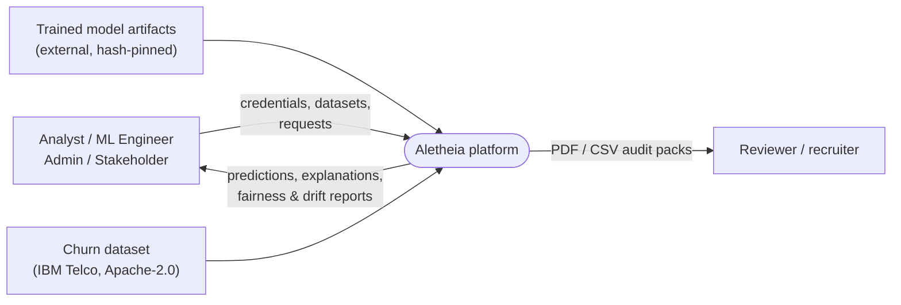

---

## 2. Dataset onboarding

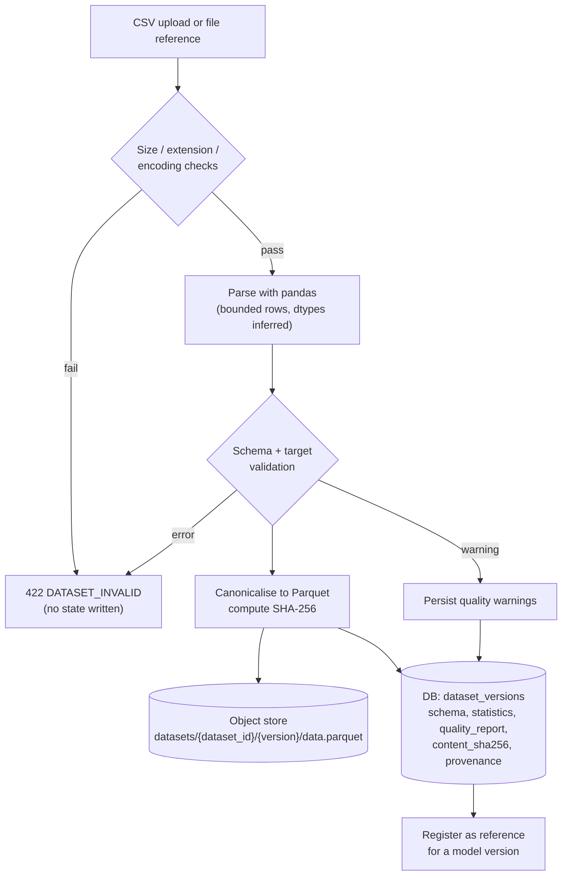

Key rules: content hash is computed on the canonical Parquet (stable column order, UTC timestamps), so
re-uploading identical data cannot create a second version; the raw upload is discarded after
canonicalisation unless `KEEP_RAW_UPLOADS=true`.

---

## 3. Model registration and activation

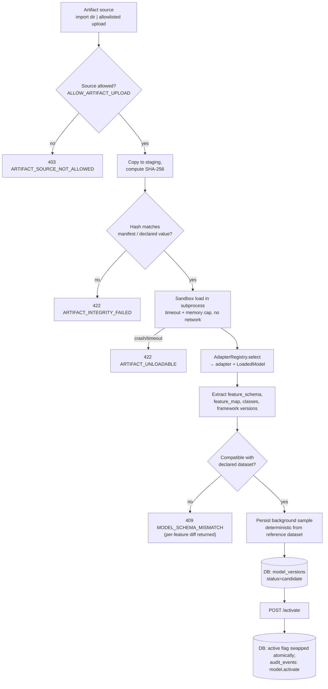

The artifact and its metadata are the *only* source of the feature contract. No schema is hand-written for a
model; it is derived from the fitted transformer and then frozen into `model_versions.feature_schema`.

---

## 4. Prediction (single and batch)

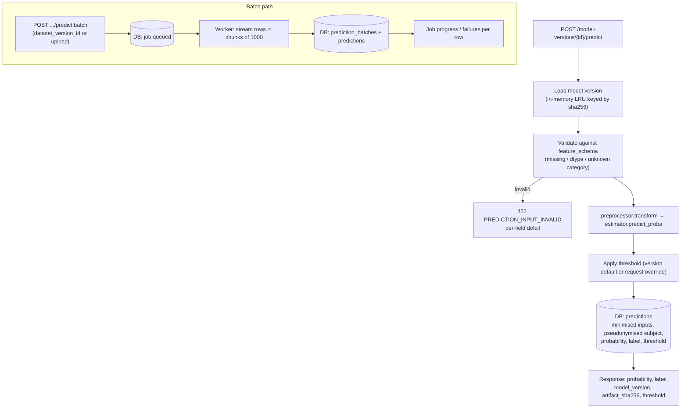

Reproducibility: the response echoes `model_version_id`, `artifact_sha256`, `threshold` and the
`preprocessor`/`estimator` versions, so any prediction can be re-derived later even after a new version is
activated.

---

## 5. Global explanation

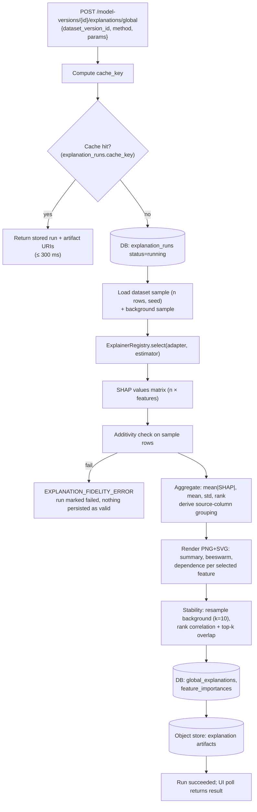

Caching is content-addressed (`artifact_sha256 | reference_hash | input_hash | method | params |
library_versions`), so cached explanations are never stale — they are keyed on immutable inputs.

---

## 6. Local explanation

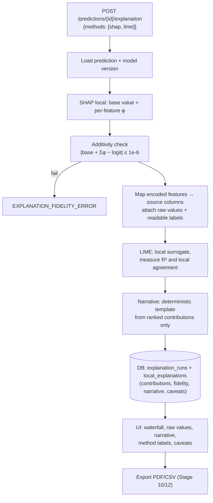

SHAP and LIME are stored as **separate rows with separate methods**; the UI shows them side by side with
their fidelity numbers and never averages or merges them. Negative contributions are phrased as
"would have reduced the predicted risk, according to the model", never as prescriptions.

---

## 7. Fairness assessment

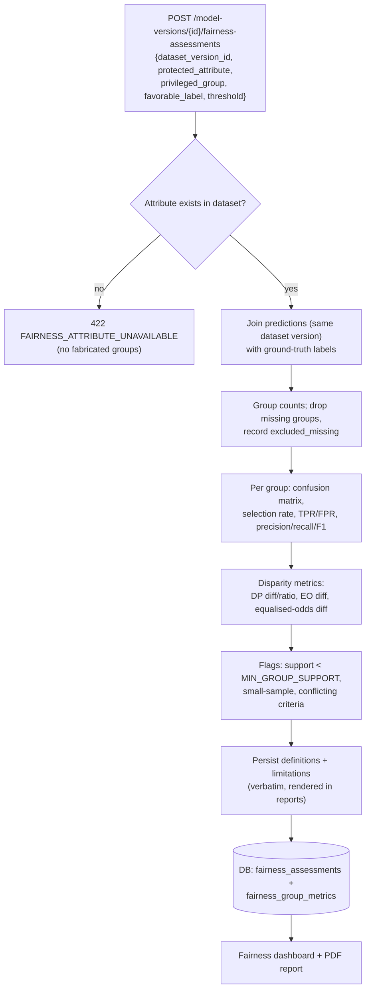

The distribution join requires that the assessment dataset version has both labels and the group attribute.
If labels are absent, the API returns `FAIRNESS_LABELS_UNAVAILABLE` rather than computing metrics against
predictions.

---

## 8. Evaluation and calibration

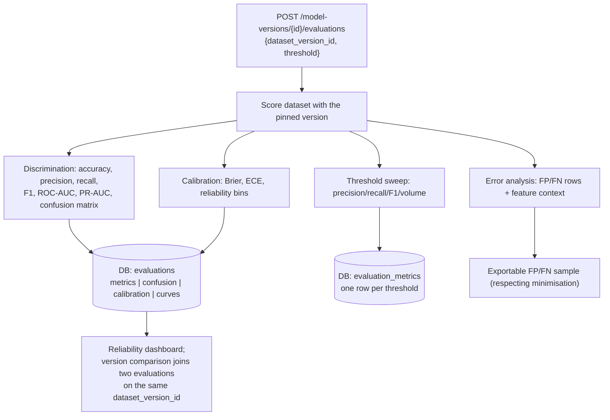

Evaluation always uses an explicitly chosen dataset version and records it, so comparisons cannot silently
use different data.

---

## 9. Drift monitoring

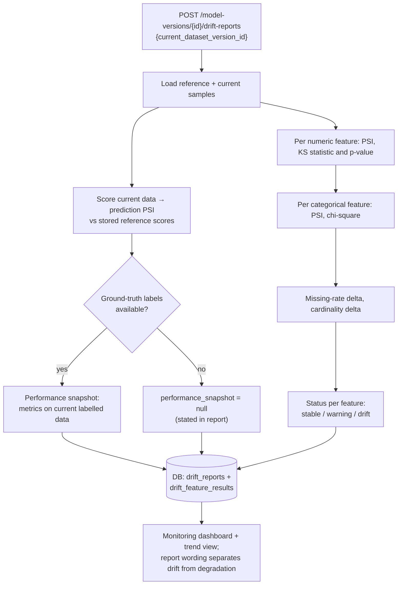

---

## 10. Reporting and export

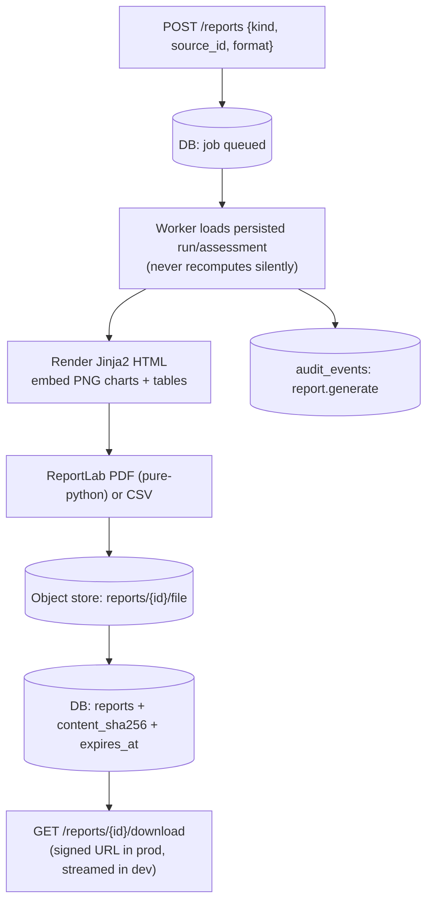

Reports render from stored findings, so a report regenerated months later reproduces the original numbers
and caveats rather than recomputing against changed data.

---

## 11. Cross-cutting flows

### 11.1 Request lifecycle

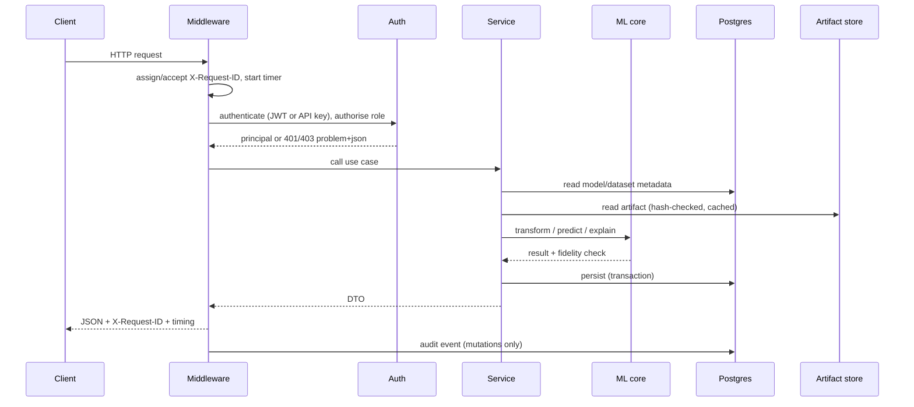

### 11.2 Explanation cache lifecycle

```text
key = sha256(artifact_sha256 | reference_dataset_hash | input_row_hash | method | params | lib_versions)
INSERT ... ON CONFLICT (cache_key) DO NOTHING   → winner computes
loser polls explanation_runs.status             → returns stored result on success
failed run deletes its cache_key row            → next request recomputes
```

This prevents duplicate expensive work under concurrent requests without introducing a cache service.

### 11.3 Graceful shutdown

```text
SIGTERM → stop accepting new requests (readiness=false)
        → worker stops claiming jobs
        → in-flight jobs marked 'interrupted' with progress preserved
        → process pool drained, sessions closed
        → exit 0
On restart, 'interrupted' jobs are re-queued if attempts < max_attempts.
```

---

## 12. Data classification (drives masking and export rules)

| Class | Examples | Storage | Export |
|---|---|---|---|
| Direct identifier | `customerID` | Not stored raw; salted hash only | Never exported |
| Sensitive attribute | `gender`, `SeniorCitizen` | Stored for fairness only; excluded from minimised prediction payloads | Aggregated only, never per-row in reports |
| Quasi-identifier | `tenure`, `Contract`, `MonthlyCharges` | Stored according to minimisation policy | Allowed with retention policy applied |
| Model artefact | joblib/UBJ, background sample | Artifact store, hash-pinned | Not exportable via public API |
| Derived evidence | SHAP matrices, metrics, curves | JSONB + object store | Exportable (PDF/CSV) |
