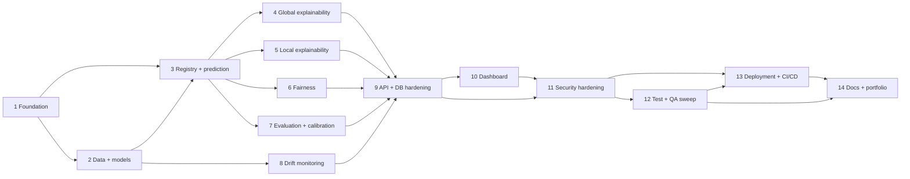
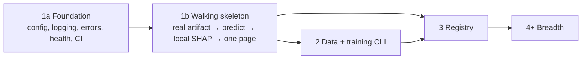

# Development Plan — Stages 1–14

Each stage follows the mandated workflow: **Analyze → Plan → Implement → Validate → Audit → Remediate →
Document → Report → Gate**. A stage closes only when its gate criteria are met with recorded evidence.
Estimates are working-day estimates for one developer and are not commitments.

---

## 0. Dependency map

Critical path: 1 → 2 → 3 → (4,5,6,7,8) → 9 → 10 → 11 → 12 → 13 → 14.

### 0.1 Execution order: walking skeleton first

The design review's strongest objection to this plan was sequencing, not scope: fourteen horizontal gates
can reach Stage 12 with nothing end-to-end demonstrable. Execution order is therefore:

Gate 1b passes only when one command brings the stack up from a cold start and a real artifact is scored
and explained through the same code path the API will use — with a screenshot committed to the README. The
breadth graph above still describes *what* gets built; this section describes *when*.

Rework is removed from the plan as well: Stages 3–8 no longer build throwaway "subset" routers. Each stage
adds endpoints to its own router module, and Stage 9 becomes "wiring, pagination, idempotency and rate
limiting across all routers" rather than a rewrite. Estimated at 4 days, that stage was previously
under-budgeted for a rewrite it no longer performs.

---

## Stage 1 — Repository foundation and engineering infrastructure
**Effort:** 2 days

**Objectives.** A clean, runnable skeleton with configuration, logging, error conventions, linting, typing,
Docker, CI and testing conventions — before any ML code exists.

**Deliverables.**
- `pyproject.toml` with pinned ranges + `requirements.lock`; Python 3.11 target (matches the interpreter
  verified in Stage 0 and the widest wheel availability for the ML stack).
- `src/aletheia/{api,core,db,ml,services,schemas,reporting}`, `dashboard/`, `tests/{unit,integration,e2e,contracts}`.
- `core/config.py` (pydantic-settings, fail-fast), `core/logging.py` (structlog JSON + redaction),
  `api/errors.py` (RFC 9457 mapping), `api/middleware.py` (request ID, timing).
- `/health`, `/health/ready` returning real checks (DB ping, migration head).
- Ruff + MyPy + pytest config, import-graph architecture test, Dockerfile.api, docker-compose with Postgres,
  GitHub Actions (lint → types → unit → integration → image build).

**Gate.**
1. `docker compose up` → API healthy, `GET /health/ready` returns `{"status":"ok"}` with a real DB check.
2. `pytest` runs (even if only infrastructure tests) and passes; CI pipeline green on a pushed branch.
3. Ruff and MyPy clean; architecture test fails if `ml/` imports `api/`/`db/` (proven by a deliberate
   temporary violation that is then reverted).
4. No secret in git (`git grep` + CI secret scan); `.env.example` complete.

---

## Stage 2 — Dataset engineering and model development
**Effort:** 3 days

**Objectives.** A reproducible training pipeline that produces artifacts the platform can register, plus honest
evaluation documentation.

**Deliverables.**
- `scripts/fetch_datasets.py` (IBM Telco, SHA-256 verification, provenance file).
- `scripts/train_churn.py`: load → validate (Pydantic schema) → clean (`TotalCharges` blanks) → stratified
  60/20/20 split with fixed seed → preprocess fitted on train only → train LogisticRegression (balanced),
  RandomForest, XGBoost → 5-fold CV on train → evaluate on validation → threshold selection rule
  (max precision s.t. recall ≥ 0.70) → single held-out test evaluation → quality gate (ROC-AUC ≥ 0.80) →
  serialise canonical artifact bundle (model, preprocessor, feature schema, feature map, background sample,
  metrics, provenance, library versions) + model card.
- `docs/model-card.md`, `docs/training.md`, metrics JSON committed under `reports/training/`.
- Committed synthetic fixture (≤200 rows) for tests; full dataset gitignored.

**Gate.**
1. Two consecutive runs produce identical metrics for a fixed seed (determinism check).
2. No test-set leakage: a test asserts transformers are fitted on train indices only.
3. Documented metrics for all three models; selection justified on validation criteria, not accuracy alone.
4. Artifact bundle loads through a throwaway script and reproduces its stored metrics within 1e-9 on the same
   split.
5. Smoke-test metrics on the synthetic fixture are labelled as such everywhere they appear.

---

## Stage 3 — Model ingestion and prediction engine
**Effort:** 3 days

**Objectives.** A generic registry and prediction service with adapters, schema validation and lineage.

**Deliverables.**
- `ModelAdapter` protocol, `AdapterRegistry`, `sklearn_pipeline`, `sklearn_composite`, `xgboost_native`.
- Artifact loader with hash verification + subprocess sandbox + manifest translation.
- Feature-schema extraction, compatibility diff, `FeatureMap` (with `num__`/`cat__` normalisation).
- `scripts/register_churn.py` importing the existing `model_v1.joblib` through the public API.
- Prediction service: single + batch job, threshold override, minimised persistence, pseudonymised subject,
  in-memory cache keyed by artifact hash.
- API: models, versions, activation, compatibility, predictions, jobs (subset complete for these flows).

**Gate.**
1. Existing churn artifact registers, activates and scores correctly; a recorded sample prediction matches the
   Stage 0 probe (probability 0.8096 for the same input, tolerance 1e-6).
2. XGBoost artifact trains and registers through the same interface — one test parametrised over both adapters.
3. Invalid input returns per-field `422`; schema mismatch returns `409` with a feature diff; tampered artifact
   returns `422 ARTIFACT_INTEGRITY_FAILED`.
4. Every prediction row resolves to model version, artifact hash and dataset version (integration test).
5. Batch of 7,043 rows completes as a job with correct row count and no duplicates (idempotent re-run test).

---

## Stage 4 — Global explainability engine
**Effort:** 3 days

**Objectives.** Faithful, cached, reproducible global SHAP analysis across model types.

**Deliverables.**
- Explainer registry (Linear/Tree/Kernel) with explicit selection and documented limits.
- SHAP matrix computation, mean |SHAP| importance, source-column aggregation, native-importance comparison.
- Plot generation: summary, beeswarm, dependence (+ interaction colouring where computed) → PNG + SVG.
- Additivity verifier; stability analysis across 10 background resamples (Spearman + top-k overlap).
- Content-addressed cache; explanations persisted with caveats.

**Gate.**
1. Additivity |base + Σφ − output| ≤ 1e-6 on a 200-row sample for both linear and tree models.
2. Top features for the churn model are stable and match a recorded expectation set; instability is reported
   with its measured correlation, not hidden.
3. Cache: identical request returns `cache_hit=true` with byte-identical artifacts; changing the reference
   version produces a new run.
4. Feature names map to source columns; grouped view sums exactly to the ungrouped total (tolerance 1e-12).
5. Global run on 7k rows stays within the 20 s budget on the reference machine (measured and recorded).

---

## Stage 5 — Local explainability engine
**Effort:** 3 days

**Objectives.** Per-prediction explanations that a non-specialist can act on and an auditor can verify.

**Deliverables.**
- SHAP local (waterfall/force-equivalent), contributions with raw values and readable labels.
- LIME local with surrogate fidelity metrics; stored separately.
- Deterministic narrative templates (direction, rank, raw value, unit) with wording tests.
- Local explanation API + artifact export (PNG/CSV).
- Caveat text persisted with every result.

**Gate.**
1. Additivity per row ≤ 1e-6; a deliberately broken explainer fixture raises `EXPLANATION_FIDELITY_ERROR`
   and persists nothing as valid.
2. Narrative references only features present in the contribution list (property-style test over 100 rows) and
   never uses causal verbs (banned-word test).
3. LIME fidelity reported per explanation; a test asserts SHAP and LIME are stored with distinct methods and
   are never merged in the response schema.
4. Raw values match the input row exactly for each referenced feature.

---

## Stage 6 — Fairness, bias and responsible-AI engine
**Effort:** 3 days

**Objectives.** Correct group-level analysis with explicit definitions and honest limitations.

**Deliverables.**
- Group metrics from persisted confusion cells; DP difference/ratio, equal opportunity, equalised odds, gaps.
- Declaration-required API (attribute, privileged group, favourable label, threshold).
- Small-sample handling, missing-group accounting, conflicting-criteria notes.
- Fairness figures (group bars, disparity chart, support table) + report section.

**Gate.**
1. Parity with Fairlearn ≤1e-9 on shared fixtures (binary, both group orders, missing values present).
2. Hand-computed fixture matches exactly for accuracy/precision/recall/FPR/FNR/selection rate.
3. A subgroup below minimum support is flagged and the response carries no disparity verdict.
4. Missing attribute → `422`; missing labels → `422`; no fabricated groups (tests).
5. Limitations text is present in every assessment response and in the exported report.

---

## Stage 7 — Evaluation and reliability analysis
**Effort:** 2 days

**Objectives.** Reliability beyond accuracy, with calibration clearly separated from discrimination.

**Deliverables.**
- Metric suite + confusion matrix; ROC/PR curves; threshold sweep table.
- Calibration: Brier, ECE, reliability bins, curve; explicit note on the class-weighted model's miscalibration.
- Error analysis with FP/FN samples and feature context; subgroup performance reuse from Stage 6.
- Version comparison on a shared dataset version.

**Gate.**
1. Re-running an evaluation yields identical metrics (determinism).
2. Calibration metrics are computed on the same rows as discrimination metrics (row-count assertion).
3. Threshold sweep precision/recall are monotone in the expected direction at the extremes (0 and 1).
4. Comparison endpoint rejects differing dataset versions with a clear error.
5. Brier and ECE are reported for both models; the churn model's miscalibration is visible in the numbers.

---

## Stage 8 — Data drift and model monitoring
**Effort:** 2 days

**Objectives.** Trustworthy drift detection that never masquerades as performance monitoring.

**Deliverables.**
- PSI (numeric binned + categorical), KS, chi-square, missing-rate and cardinality deltas.
- Prediction-distribution drift against stored reference scores.
- Per-feature status with configurable thresholds; historical reports and trend view.
- Performance snapshot populated only when labels exist.

**Gate.**
1. PSI(x, x) = 0; a known shift produces a PSI above threshold (fixture-verified); KS p-value direction is
   correct on synthetic shifts.
2. Insufficient data (e.g. a feature with <2 populated bins) returns `INSUFFICIENT_DATA`, not a fake number.
3. Without labels, `performance_snapshot` is null and the response states performance was not measured.
4. Report wording test asserts the drift/degradation distinction.

---

## Stage 9 — Backend API and database engineering
**Effort:** 4 days

**Objectives.** Complete, consistent, documented API over the full domain model with migrations and auth.

**Deliverables.**
- All routers in `docs/06-api-specification.md`; OpenAPI snapshot committed.
- Alembic migrations to head with downgrade paths; schema-drift CI check.
- Auth (JWT + API keys), RBAC, rate limiting, pagination, idempotency, audit events.
- Repository layer; transaction boundaries; centralised exception handling; request-ID propagation.
- Contract and integration tests across the endpoint matrix.

**Gate.**
1. Endpoint matrix covered: success, 401, 403, 404, 422, 409, 429 (rate-limit test with a tiny budget).
2. `alembic upgrade head` on an empty DB reproduces the ORM schema exactly (automated diff).
3. Keyset pagination has no duplicates/gaps under concurrent inserts.
4. Audit rows written for register/activate/delete/export; redaction test proves no secrets or PII in logs.
5. p95 latency measured for prediction and local explanation against the NFR budgets.

---

## Stage 10 — Interactive dashboard
**Effort:** 5 days

**Objectives.** A polished, stakeholder-usable product surface with executive/technical separation.

**Deliverables.** Eight pages: Executive Overview, Model Explorer, Global Explainability, Prediction Explorer,
Fairness, Reliability, Monitoring, Reports. Shared components: metric cards, caveat banners, plot builders,
tables, export buttons. API client with typed calls and error rendering.

**Gate.**
1. Full workflow completed through the UI: select model → predict → explain globally → explain locally →
   fairness → drift → export PDF.
2. Every page degrades gracefully when a capability is unavailable (no traceback, no empty chart).
3. Caveats visible on explanation, fairness and drift pages (screenshot evidence in `docs/assets/`).
4. Dashboard performs no direct DB or artifact access (architecture test).
5. Usability pass with a non-ML reader: each page's executive summary understandable without reading metrics
   (recorded notes, issues fixed).

---

## Stage 11 — Production hardening and security
**Effort:** 3 days
**Objectives.** Close the security, resilience and privacy gaps identified in the risk register.

**Deliverables.**
- Hardened artifact trust policy; upload restrictions and validation; file-size and content-type limits.
- Secret management review; secret scan in CI; log redaction tests.
- Rate limiting per identity; DB pool sizing and timeouts; request size limits; timeouts on ML calls.
- Retention job with dry-run and batched deletion; de-pseudonymisation with audit.
- Graceful shutdown and job recovery; readiness reflects migrations and worker heartbeat.
- `docs/11-security.md` with threat model and explicit residual risks.

**Gate.**
1. Documented attack scenarios executed: tampered artifact, oversized upload, CSV formula injection in export,
   path traversal in artifact filename, unauthorised de-pseudonymisation — each produces the intended refusal.
2. No secret or PII in logs (grep-based test over a captured log stream from the e2e run).
3. `SIGTERM` during a running job leaves `interrupted` + progress; restart re-queues it and it completes.
4. Retention dry-run reports counts without deleting; real run deletes only expired rows (row-count assertions).

---

## Stage 12 — Testing and quality assurance sweep
**Effort:** 4 days
**Objectives.** Prove correctness across units, integrations and the end-to-end workflow; document what is not
covered.

**Deliverables.**
- Unit: adapters, feature mapping, metrics, fairness, drift, narrative, reports.
- Integration: registration → prediction → explanations → fairness → drift → report against Postgres.
- E2E: the full workflow via the API, plus a dashboard-client smoke path.
- Edge cases from the prompt: missing features, wrong dtypes, unseen categories, empty dataset, unsupported
  model type, multiclass adapter path, missing sensitive attribute, small group, corrupt artifact, explainer
  failure, insufficient drift samples.
- `docs/12-testing.md` with the matrix and measured coverage; mutation-style spot checks on key metrics.

**Gate.**
1. All suites green on Linux CI; coverage ≥85% on `ml/` and `services/` (measured, reported).
2. Every edge case listed above has an automated test with an assertion on the specific error or degraded
   behaviour.
3. No skipped tests without a documented reason; no xfail hiding a real bug.
4. `mypy` clean on `ml/` and `services/`; Ruff clean.
5. Reproducibility sweep: re-running the e2e workflow twice yields identical stored metrics and explanation
   values.

---

## Stage 13 — Deployment, CI/CD and MLOps
**Effort:** 3 days
**Objectives.** One-command local stack, a costed public demo path, and a documented production path.

**Deliverables.**
- Production Dockerfiles (multi-stage, non-root, healthcheck), Compose stack, `.env.example`.
- CI/CD: lint → types → unit → integration → image build; migration job; deployment workflow with manual
  approval and health verification.
- Artifact bootstrap (fetch data → train → register) as a documented pipeline step.
- `docs/13-deployment.md` (AWS reference + cheaper alternatives + cost estimates), runbook.
- Monitoring: structured logs, readiness, optional Prometheus endpoint.

**Gate.**
1. Fresh clone → `docker compose up` → seeded demo state → full workflow works, documented step by step.
2. CI green end to end; images build reproducibly (same tag from same commit).
3. Deployment smoke test: `/health/ready` ok, one prediction and one explanation succeed against the deployed
   instance (recorded output).
4. Migration procedure tested on a database with existing data (upgrade without data loss).
5. Costs stated as estimates with the caveat that pricing must be re-verified.

---

## Stage 14 — Documentation, demonstration and portfolio readiness
**Effort:** 3 days
**Objectives.** Make the work legible and verifiable to a reviewer in under 10 minutes.

**Deliverables.**
- Final README (problem, architecture, results, limitations, quickstart), architecture/ER/data-flow docs
  refreshed to match code, methodology docs (explainability, fairness, evaluation), security doc, testing doc,
  known limitations, roadmap.
- Screenshots of every dashboard page, a recorded demo walkthrough, an example exported PDF, an example local
  explanation, and the measured evaluation summary.
- Resume bullets and interview talking points that cite only measured, reproducible numbers.
- Final acceptance audit against the Definition of Done.

**Gate.**
1. Definition of Done checklist from the master prompt fully satisfied, each item linked to evidence.
2. Every numeric claim in README/docs traceable to a script output or a recorded artifact.
3. A new reader can run the demo from the README alone (verified by following it verbatim on a clean shell).
4. Known limitations section published, including dataset fairness limits and sandbox residual risk.

---

## Cross-stage quality gates

| Gate | Applies to | Rule |
|---|---|---|
| G1 Reproduction | every stage | Recomputed results match stored results (1e-9 for metrics, 1e-6 for SHAP) |
| G2 No fabrication | every stage | Any number in docs is produced by a script or explicitly attributed |
| G3 Coverage | 3–13 | ≥85% on changed `ml/` + `services/` modules |
| G4 Types/lint | every stage | MyPy on `ml/`+`services/`, Ruff everywhere, zero errors |
| G5 Lineage | 3+ | Every persisted analytical row resolves to model + dataset version |
| G6 Documentation | every stage | Docs updated in the same stage as the code |

---

## Effort summary

| Stage | Days | Cumulative |
|---|---|---|
| 1a Foundation | 2 | 2 |
| 1b Walking skeleton | 3 | 5 |
| 2 Data + training CLI | 3 | 8 |
| 3 Registry | 3 | 11 |
| 4 Evaluation | 3 | 14 |
| 5 Global explanations | 3 | 17 |
| 6 Local explanations | 3 | 20 |
| 7 Fairness | 2 | 22 |
| 8 Drift | 2 | 24 |
| 9 API + persistence | 4 | 28 |
| 10 Dashboard | 5 | 33 |
| 11 Security hardening | 3 | 36 |
| 12 Test + QA sweep | 4 | 40 |
| 13 Deployment + CI/CD | 3 | 43 |
| 14 Docs + portfolio | 3 | 46 |

46 planned days. The earlier 43 did not include the skeleton and assumed Stage 9 could wire eight stages of
routers in four days. With a 30% contingency — normal for a single developer on a first-of-its-kind build —
plan for **~60 working days**; part-time at 10 h/week that is roughly 12–14 weeks. These are estimates; the
gates, not the calendar, decide completion.

---

## What was built first

Stage 1a (foundation) and the core of Stage 1b, in that order:

1. Configuration, structured logging, error taxonomy, health/readiness, CI and container — reviewable in
   isolation, with no domain code to distract from it.
2. The composite adapter, feature map, local SHAP and the additivity gate. These were pulled forward out of
   Stage 2 because they carry the product's central claim (an explanation must reconstruct the model's own
   output) and were the riskiest thing to defer.

Verified state: 111 tests passing, 94% line coverage on `aletheia.ml` + `aletheia.core`, ruff and mypy clean,
health endpoints exercised over HTTP. The dashboard page that completes gate 1b is the next piece of work;
see the README and `docs/10-review-remediation.md` for exactly what that gate still requires.
